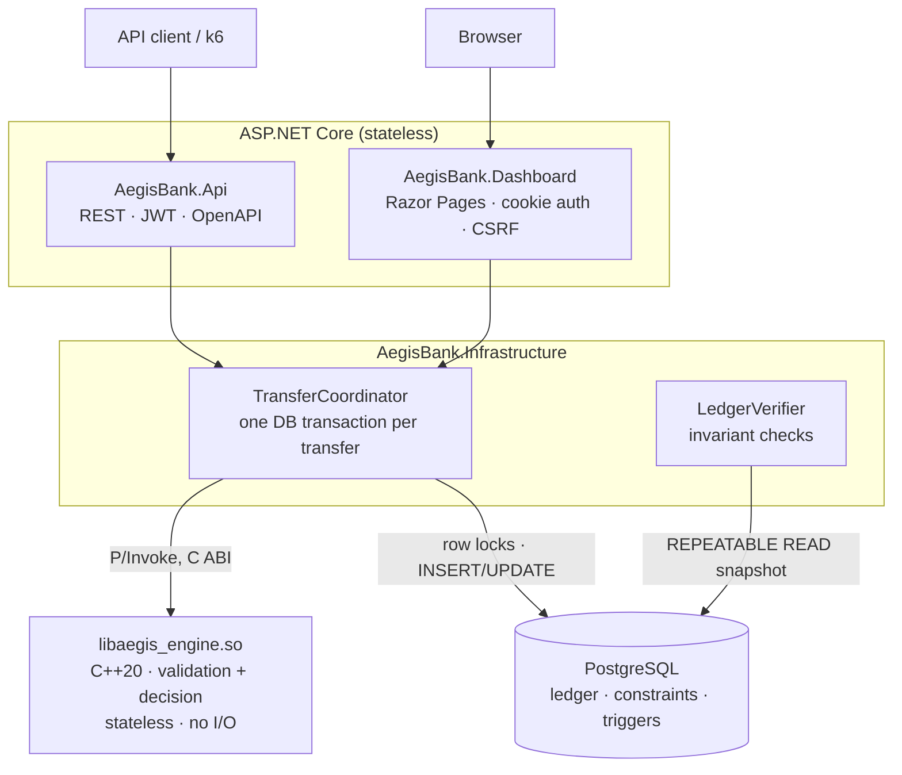

# AegisBank

**High-Performance Banking Transaction Engine** — a simulated core-banking
back end built to show how money movement is kept correct under concurrency:
a C++20 decision engine, an ASP.NET Core transaction coordinator, a
double-entry ledger in PostgreSQL, and the tests that try to break them.

> **Simulation only.** AegisBank is an educational portfolio project. It does
> not connect to any banking network, does not move real money, contains only
> fictional people and accounts, and is not certified or audited for
> production use.

## Contents

1. [What it does](#what-it-does)
2. [Architecture](#architecture)
3. [Technology](#technology)
4. [Engineering challenges](#engineering-challenges)
5. [C++ and .NET interoperability](#c-and-net-interoperability)
6. [How a transfer is processed](#how-a-transfer-is-processed)
7. [Double-entry ledger](#double-entry-ledger)
8. [Concurrency safety](#concurrency-safety)
9. [API](#api)
10. [Running it](#running-it)
11. [Tests](#tests)
12. [Benchmarks](#benchmarks)
13. [Screenshots](#screenshots)
14. [Security](#security)
15. [Verification status](#verification-status)
16. [Known limitations](#known-limitations)
17. [Disclaimer](#disclaimer)

## What it does

- Customer accounts, opened with a zero balance and funded only through
  balanced journal entries.
- Internal transfers decided by a native C++ engine and committed in a single
  PostgreSQL transaction together with their journal, ledger lines, balance
  updates, audit record and idempotent response.
- Exactly-once semantics for retried requests through an `Idempotency-Key`.
- A ledger that the database itself keeps balanced and immutable, with
  reversals instead of edits.
- On-demand reconciliation of every stored balance against the ledger.
- A REST API (JWT) and an internal operations console (Razor Pages, cookies).
- Automated tests for the financial invariants, including concurrent
  overdraft attempts, duplicate submissions, injected failures and restarts,
  all against real PostgreSQL.

## Architecture



The engine decides; the coordinator persists; the database enforces. The
engine never touches the database, and the coordinator never decides whether
a transfer is allowed. Details: [docs/architecture.md](docs/architecture.md).

```
src/
  AegisBank.Engine/          C++20 engine, C ABI, GoogleTest suite, native benchmark
  AegisBank.Domain/          entities, enums, currency (no dependencies)
  AegisBank.Application/     contracts, DTOs, request fingerprint
  AegisBank.Infrastructure/  EF Core, migrations, P/Invoke wrapper, coordinator, verifier, auth
  AegisBank.Api/             REST API host
  AegisBank.Dashboard/       Razor Pages operations console
tests/
  AegisBank.UnitTests/         domain rules, fingerprint, native interop and struct layout
  AegisBank.IntegrationTests/  API, authorization, validation, database triggers, dashboard
  AegisBank.ConcurrencyTests/  scenarios A/B/C, deadlock shape, failure injection, restart
benchmarks/                  BenchmarkDotNet project, k6 script, result summariser
database/                    schema script and notes
docs/                        architecture, transaction flow, ledger, security, benchmarks, limitations
```

## Technology

| Layer | Choice |
|---|---|
| Transaction engine | C++20, CMake, GoogleTest, shared library with a versioned C ABI |
| Back end | C# / .NET 10 (LTS), ASP.NET Core Web API, EF Core 10, Npgsql |
| Dashboard | ASP.NET Core Razor Pages, hand-written CSS, server-rendered SVG chart, no JavaScript framework (no JavaScript at all) |
| Database | PostgreSQL 17, EF Core migrations, check constraints, constraint triggers |
| Auth | JWT bearer with rotating refresh tokens (API); cookie + antiforgery (dashboard); `PasswordHasher` from ASP.NET Core Identity |
| Tests | GoogleTest, xUnit, `WebApplicationFactory`, real PostgreSQL |
| Performance | Custom native benchmark, BenchmarkDotNet, k6 |
| Delivery | Docker (multi-stage), Docker Compose, GitHub Actions |

## Engineering challenges

**Two requests must not spend the same money.** Balances are read only from
rows locked `FOR UPDATE` in the transaction that will change them. The second
of two competing transfers waits, then sees the reduced balance and is
rejected by the engine.

**A retried request must not pay twice, even when the retry races the
original.** The idempotency key is claimed with an `INSERT … ON CONFLICT`
inside the same transaction that posts the transfer. A concurrent duplicate
blocks on the unique index until the first commits, then replays the stored
response. There is no intermediate state to get stuck in.

**The ledger must balance without trusting the application.** A deferred
constraint trigger rejects, at commit, any journal whose debits and credits
differ. Other triggers make posted rows immutable and prevent any later
transaction from adding lines to an existing journal.

**Native code inside a managed service.** The engine exposes a small C ABI
with size- and version-stamped structs. The managed side verifies the layout
against the loaded library at start-up and fails readiness if they disagree.

**Proving it.** Reconciliation recomputes every balance from the ledger in
one snapshot. The concurrency tests run it after hammering the system from
two simulated application instances.

## C++ and .NET interoperability

The engine's public surface is one C header,
[`engine.h`](src/AegisBank.Engine/include/aegis/engine.h):

```c
typedef struct aegis_transfer_request {
    uint32_t struct_size;      /* sizeof(aegis_transfer_request) */
    uint32_t abi_version;      /* AEGIS_ABI_VERSION */
    aegis_account_snapshot debit_account;
    aegis_account_snapshot credit_account;
    int64_t  amount_minor;
    uint32_t currency;         /* ISO 4217 numeric */
    uint32_t reserved;
} aegis_transfer_request;      /* 88 bytes */

int32_t aegis_evaluate_transfer(const aegis_transfer_request* request,
                                aegis_transfer_decision* decision);
```

- Explicit-width integers, fixed layouts checked by `static_assert`.
- Caller-owned memory only; the engine allocates nothing for the caller and
  returns only static strings.
- No STL type and no exception crosses the boundary.
- Stateless and thread-safe.

On the managed side, `[LibraryImport]` generates the stubs, the mirror structs
are blittable and live on the stack, and `NativeTransferEngine` copies the
result into a managed value type. At start-up it compares
`sizeof`/`offsetof` values reported by the library with the managed layout.
A unit test does the same and fails the build pipeline on any drift.

The engine does real work: it validates amount, account identity, currency,
account status, sufficient funds and arithmetic overflow, and produces the
resulting balances and the two ledger instructions. The coordinator then
cross-checks that decision before writing anything.

## How a transfer is processed

```mermaid
sequenceDiagram
    autonumber
    participant C as Client
    participant A as ASP.NET Core
    participant T as TransferCoordinator
    participant P as PostgreSQL
    participant E as C++ engine

    C->>A: POST /api/transfers (Idempotency-Key)
    A->>T: authenticated, validated request
    T->>P: BEGIN
    T->>P: claim idempotency key (INSERT ... ON CONFLICT DO NOTHING)
    Note over T,P: duplicate key: wait for the first request, then replay or 409
    T->>P: lock both accounts FOR UPDATE, lower id first
    T->>E: evaluate(snapshots, amount)
    E-->>T: decision + balances + debit/credit instructions
    T->>P: insert transfer, journal, ledger lines, audit; update balances
    T->>P: store response in idempotency record
    T->>P: COMMIT (deferred triggers verify the journal balances)
    T-->>A: 201 Created / 422 rejected
    A-->>C: response
```

Full description, including retry rules and failure cases:
[docs/transaction-flow.md](docs/transaction-flow.md).

## Double-entry ledger

The books are kept from the bank's point of view. Customer deposits are
**liabilities** (credit-normal); the system account *Vault cash* is an
**asset** (debit-normal).

```text
Opening deposit, Rp 100.000,00
    Dr  Vault cash (asset ↑)             100.000,00
        Cr  Customer account (liability ↑)           100.000,00

Internal transfer, Rp 80.000,00
    Dr  Sender's account (liability ↓)    80.000,00
        Cr  Recipient's account (liability ↑)         80.000,00
```

- Amounts are 64-bit integers in minor units. No floating point.
- Ledger lines are authoritative; account balances are projections updated
  in the same transaction.
- Posted rows cannot be updated or deleted. Corrections are reversal entries.
- Total assets always equal total liabilities; internal transfers leave total
  customer funds unchanged.

More: [docs/ledger-design.md](docs/ledger-design.md).

## Concurrency safety

| Risk | Protection |
|---|---|
| Lost update / double spend | Row locks on both accounts; balance read under the lock |
| Duplicate submission | Idempotency claim inside the posting transaction; unique `(user, key)` on both `idempotency_records` and `transfers` |
| Deadlock | Locks always taken in ascending account-id order; idempotency row always first |
| Deadlock or serialization failure anyway | Whole unit of work retried, bounded, with backoff; nothing else is retried |
| Partial write | One transaction; any exception rolls back everything |
| Unbalanced or altered ledger | Deferred balance trigger, immutability triggers, check constraints |
| Multiple app instances | No in-process locking is relied on; the database is the only coordinator |

## API

OpenAPI: `http://localhost:8080/swagger` when the stack is running.

| Area | Endpoints |
|---|---|
| Auth | `POST /api/auth/login` · `POST /api/auth/refresh` · `POST /api/auth/logout` · `GET /api/auth/me` |
| Accounts | `GET /api/accounts` · `GET /api/accounts/{id}` · `GET /api/accounts/{id}/balance` · `GET /api/accounts/{id}/transactions` |
| Transfers | `POST /api/transfers` · `GET /api/transfers` · `GET /api/transfers/{id}` |
| Ledger (staff) | `GET /api/ledger` · `GET /api/ledger/{journalId}` · `GET /api/ledger/verify` |
| Admin (staff) | `GET /api/admin/overview` · `GET /api/admin/transactions` · `GET /api/admin/audit-logs` · `GET /api/admin/system-health` |
| Admin (admin only) | `POST /api/admin/customers` · `POST /api/admin/accounts` · `POST /api/admin/accounts/{id}/deposits` · `PUT /api/admin/accounts/{id}/status` · `POST /api/admin/transfers/{id}/reversal` |
| Health | `GET /health/live` · `GET /health/ready` |

List endpoints take `page`, `pageSize` (1–200), `sort` (`field:asc|desc`,
whitelisted) and filters, and return
`{ items, page, pageSize, totalCount, totalPages }`. Errors are RFC 9457
Problem Details with `code` and `correlationId`.

```bash
# Sign in (demo user from the seed; password from your .env)
TOKEN=$(curl -s http://localhost:8080/api/auth/login \
  -H 'Content-Type: application/json' \
  -d '{"username":"ratna","password":"<SEED_CUSTOMER_PASSWORD>"}' | jq -r .accessToken)

# Own accounts
curl -s http://localhost:8080/api/accounts -H "Authorization: Bearer $TOKEN" | jq '.items[] | {id, accountNumber, availableBalanceMinorUnits}'

# Transfer Rp 50.000,00 (5,000,000 minor units)
curl -si http://localhost:8080/api/transfers \
  -H "Authorization: Bearer $TOKEN" \
  -H 'Content-Type: application/json' \
  -H 'Idempotency-Key: order-2026-0001' \
  -d '{"sourceAccountId":"<your account id>","destinationAccountId":"<another account id>","amountMinorUnits":5000000,"currency":"IDR"}'
```

```http
HTTP/1.1 201 Created
Location: /api/transfers/01a1e2b2-...
Idempotent-Replayed: false

{ "id": "01a1e2b2-...", "referenceNumber": "TRF-20261116-7FS13FVWHW", "kind": "Internal",
  "status": "Completed", "amountMinorUnits": 5000000, "currency": "IDR", "journalEntryId": "01a1e2b2-...", ... }
```

Send the same request again: same body, `Idempotent-Replayed: true`, no second
posting. Change the amount but keep the key: `409 idempotency_key_conflict`.
Ask for more than the balance:

```http
HTTP/1.1 422 Unprocessable Entity
Content-Type: application/problem+json

{ "title": "Transfer rejected", "status": 422, "code": "insufficient_funds",
  "detail": "The source account does not have sufficient funds.",
  "correlationId": "...", "transfer": { "status": "Rejected", "failureCode": "INSUFFICIENT_FUNDS", ... } }
```

## Running it

### Docker Compose

Requires Docker with Compose v2.

```bash
cp .env.example .env        # then edit: at least JWT_SIGNING_KEY and POSTGRES_PASSWORD
docker compose up --build
```

| | URL |
|---|---|
| Operations console | http://localhost:8081 |
| API | http://localhost:8080 |
| OpenAPI UI | http://localhost:8080/swagger |
| PostgreSQL | `localhost:5432` (bound to 127.0.0.1) |

On first start the API applies the migrations and seeds a fictional dataset
(six customers, nine accounts, ten demo transfers). Demo users:

| Username | Role | Password variable in `.env` |
|---|---|---|
| `ops.admin` | Admin (console + API) | `SEED_ADMIN_PASSWORD` |
| `audit.viewer` | Auditor, read-only (console + API) | `SEED_AUDITOR_PASSWORD` |
| `ratna`, `bima`, `sari` | Customer (API only) | `SEED_CUSTOMER_PASSWORD` |

The image build compiles the C++ engine and runs its unit tests; a failing
native test fails the build. Data lives in the `pgdata` volume;
`docker compose down -v` removes it.

The Compose stack runs in the `Development` environment (demo seed, OpenAPI,
plain HTTP). For anything else set `ASPNETCORE_ENVIRONMENT=Production`,
`Security__RequireHttps=true`, `Seed__Enabled=false`, and supply TLS.

### Local toolchain

Requires the .NET 10 SDK, CMake ≥ 3.22, a C++20 compiler (GCC 13 tested),
GoogleTest, and PostgreSQL 17.

```bash
bash scripts/build-engine.sh              # builds the engine, runs GoogleTest, copies the library to artifacts/native
dotnet build AegisBank.slnx

export ConnectionStrings__Database="Host=localhost;Database=aegisbank;Username=aegis;Password=..."
export Jwt__SigningKey="$(openssl rand -base64 48)"
export Seed__AdminPassword=... Seed__AuditorPassword=... Seed__CustomerPassword=...

dotnet run --project src/AegisBank.Api -- seed      # migrate + demo data, then exit
dotnet run --project src/AegisBank.Api              # http://localhost:8080
dotnet run --project src/AegisBank.Dashboard        # http://localhost:8081
```

### Without a local toolchain

If the machine has Docker but no SDK or compiler (this is how the project was
developed), `scripts/dev-exec.sh` runs everything in a toolchain container:

```bash
bash scripts/dev-exec.sh up                               # toolchain container + PostgreSQL
bash scripts/dev-exec.sh "bash scripts/build-engine.sh"   # C++ build + GoogleTest
bash scripts/dev-exec.sh "dotnet test AegisBank.slnx"     # all .NET tests
bash scripts/dev-exec.sh down
```

## Tests

```bash
bash scripts/build-engine.sh                    # C++: 40 GoogleTest cases
export AEGIS_TEST_DB="Host=localhost;Port=5432;Username=aegis;Password=..."   # server only, no database name
dotnet test AegisBank.slnx                      # unit + integration + concurrency
```

Database tests create a private database per test class on the server named
by `AEGIS_TEST_DB`, apply the real migrations, and drop it afterwards. No
in-memory database is used anywhere.

| Suite | Tests | Covers |
|---|---:|---|
| `aegis_engine_tests` (GoogleTest) | 40 | every validation rule, boundary and overflow cases, determinism, C ABI argument and layout checks |
| `AegisBank.UnitTests` | 68 | fingerprint canonicalisation, key validation, money formatting/parsing, permissions, paging, **native interop and struct layout** |
| `AegisBank.IntegrationTests` | 107 | auth and token rotation, lockout, authorization and ownership, validation, transfers over HTTP, idempotency, reversal, rate limiting, **database triggers and constraints by direct SQL**, reconciliation, dashboard pages, CSRF |
| `AegisBank.ConcurrencyTests` | 18 | scenarios A, B, C below, opposing transfers, scarce funds, concurrent reversals, verification during writes, failure injection at four stages, retry on `40P01`/`40001`, cancellation, restart |

The three required scenarios
([ConcurrencyScenarios.cs](tests/AegisBank.ConcurrencyTests/ConcurrencyScenarios.cs)):

- **A** — an account holds Rp 100.000; two transfers of Rp 80.000 start at
  the same instant from two simulated instances. Exactly one completes, the
  other is rejected with `INSUFFICIENT_FUNDS`, the balance ends at Rp 20.000.
  Repeated 25 times.
- **B** — 100 identical requests with one idempotency key. All 100 receive
  the same transfer id; one transfer row, one journal, two ledger lines; 99
  responses are marked as replays.
- **C** — 1,000 valid transfers across 20 accounts with 64 in flight. All
  complete; every balance equals the sequentially computed expectation; total
  funds are unchanged; reconciliation passes.

Last full run (2026-11-16, Release build, toolchain container, PostgreSQL 17):

```text
$ bash scripts/build-engine.sh
100% tests passed, 0 tests failed out of 40

$ dotnet build AegisBank.slnx -c Release -warnaserror
Build succeeded.    0 Warning(s)    0 Error(s)

$ dotnet test AegisBank.slnx -c Release --no-build
Passed!  - Failed: 0, Passed:  68, Skipped: 0, Total:  68 - AegisBank.UnitTests.dll
Passed!  - Failed: 0, Passed: 107, Skipped: 0, Total: 107 - AegisBank.IntegrationTests.dll
Passed!  - Failed: 0, Passed:  18, Skipped: 0, Total:  18 - AegisBank.ConcurrencyTests.dll

$ dotnet ef migrations has-pending-model-changes
No changes have been made to the model since the last migration.
```

## Benchmarks

Three layers are measured separately so that CPU cost is not confused with
database cost:

| Layer | Tool | What it isolates |
|---|---|---|
| Engine only | `aegis_engine_bench` (C++) | validation and decision logic, no runtime |
| Engine through .NET | BenchmarkDotNet | P/Invoke cost; C++ engine vs. an equivalent C# implementation |
| Full stack | k6 | HTTP, auth, engine, PostgreSQL transaction, commit |

The C# implementation exists only in `benchmarks/` and is never used by the
API. Before measuring, the benchmark checks that both implementations return
identical decisions for 500,000 randomised requests.

```bash
build/engine/aegis_engine_bench benchmarks/results/native-engine.json
dotnet run -c Release --project benchmarks/AegisBank.Benchmarks -- benchmarks/results/bdn
RATE_LIMITING_ENABLED=false docker compose up -d && docker compose --profile bench run --rm k6
python benchmarks/summarize.py --machine "<cpu, memory, os>"
```

Method, environment and caveats: [docs/benchmarks.md](docs/benchmarks.md).

### Measured results

One laptop (AMD Ryzen 7 6800H, Windows 11, Docker in WSL2 with 6.6 GiB RAM),
2026-11-16. Load generator, API and database shared the machine. These are
measurements, not guarantees.

**Engine, CPU only (time per decision)**

| Path | Result |
|---|---:|
| C++ decision logic, called from C++ | 4.5 ns (replayed dataset) · 7.7 ns (1M distinct requests) |
| C ABI entry point, called from C++ | 25–26 ns |
| C ABI through raw P/Invoke | 29.5 ns |
| Production wrapper `NativeTransferEngine.Evaluate` | 64.9 ns |
| C# reference implementation (benchmark only) | 5.6 ns |

**The C# reference is about 12× faster than the C++ engine as called in
production.** The decision logic costs about the same in both languages; the
native path pays for struct conversion at the ABI and in the managed wrapper.
The P/Invoke transition itself is only about 3 ns. All of it is negligible
next to a database transaction, which is why the result does not change the
design: the engine is native to demonstrate a safe interop boundary, not to
make transfers faster.

**Full stack (k6, 32 virtual users, 60 s after 15 s warm-up, nine accounts)**

| Metric | Result |
|---|---:|
| Throughput | 260.9 transfers/s |
| Success rate | 100% (15,654 of 15,654) |
| Failure rate | 0% |
| Latency p50 / p95 / p99 | 27.5 ms / 745 ms / 1,840 ms |
| Ledger consistent afterwards | yes |

The long tail comes from 32 clients contending for nine account rows; see
[docs/benchmarks.md](docs/benchmarks.md) for the interpretation and the raw
files in [benchmarks/results](benchmarks/results/RESULTS.md).

## Screenshots

No screenshots are committed. To capture them, start the stack, sign in to
http://localhost:8081 as `ops.admin`, and save images to `docs/screenshots/`:

| Suggested file | Page |
|---|---|
| `overview.png` | `/` — figures, daily chart, recent activity |
| `transfer-simulator.png` | `/Transfers/New` — after submitting twice with the same key (shows "Replayed") |
| `ledger-explorer.png` | `/Ledger` — journals with Dr/Cr lines and the reconciliation checks |
| `transaction-detail.png` | `/Transfers/{id}` — transfer with its balanced journal |
| `monitoring.png` | `/Monitoring` — component health and recorded benchmarks |
| `audit-log.png` | `/Audit` |
| `openapi.png` | http://localhost:8080/swagger |

## Security

- Passwords: PBKDF2 via ASP.NET Core Identity's `PasswordHasher`.
- API: 10-minute JWT access tokens; refresh tokens stored hashed, rotated on
  use, family revoked on reuse.
- Dashboard: `HttpOnly`, `SameSite=Strict` cookie; antiforgery on every POST;
  strict Content-Security-Policy with no inline script or style.
- Role-based authorization (Customer, Auditor, Admin) plus ownership checks
  in the service layer; foreign resources answer 404.
- Uniform sign-in failures, account lockout, rate limiting, correlation ids,
  structured security logging, append-only audit table.
- Parameterised SQL throughout; secrets only from environment variables.
- Demo seeding is refused in the `Production` environment.

Details: [docs/security.md](docs/security.md).

## Verification status

Executed and passing on the development machine (Docker in WSL2) on 2026-11-16:

| Item | Status |
|---|---|
| C++ engine builds (GCC 13.3, `-Werror`) | verified |
| 40 GoogleTest cases pass | verified |
| .NET solution builds in Release with warnings as errors | verified |
| 68 unit, 107 integration, 18 concurrency tests pass against PostgreSQL 17 | verified |
| EF Core migrations apply to an empty database and match the model | verified |
| `docker compose up --build` starts PostgreSQL, API and dashboard, all healthy | verified |
| Demo dataset is seeded through ledger postings | verified |
| Dashboard pages render live data (signed in and inspected in a browser) | verified |
| OpenAPI document is served | verified (integration test) |
| Native, BenchmarkDotNet and k6 benchmarks run and write result files | verified |
| Ledger reconciles after a 60 s load test (about 15,700 transfers) | verified |

Not verified:

| Item | Status |
|---|---|
| GitHub Actions workflow (`.github/workflows/ci.yml`) | written, **never executed**: the repository has not been pushed |
| Build with MSVC or Clang, and on Windows or macOS natively | not attempted; only GCC on Linux was used |
| HTTPS termination and `Production` environment configuration | configuration paths exist; not exercised end to end |
| Behaviour with several API replicas behind a load balancer | simulated in tests by two service containers on one database; not deployed |
| Longer or larger load tests, other account populations | not run |

## Known limitations

Internal transfers only; one currency; two-line journals; no purge of
idempotency records; reconciliation scans the whole ledger; access tokens
are not individually revocable; rate limits are per process; single database
without replication. The full list is in
[docs/limitations.md](docs/limitations.md).

## Disclaimer

This repository is a portfolio and learning project. It simulates banking
back-end mechanics with invented data. It is not a bank, not a payment
system, and not production-certified software, and it must not be used to
hold or move real funds or real customer information.
