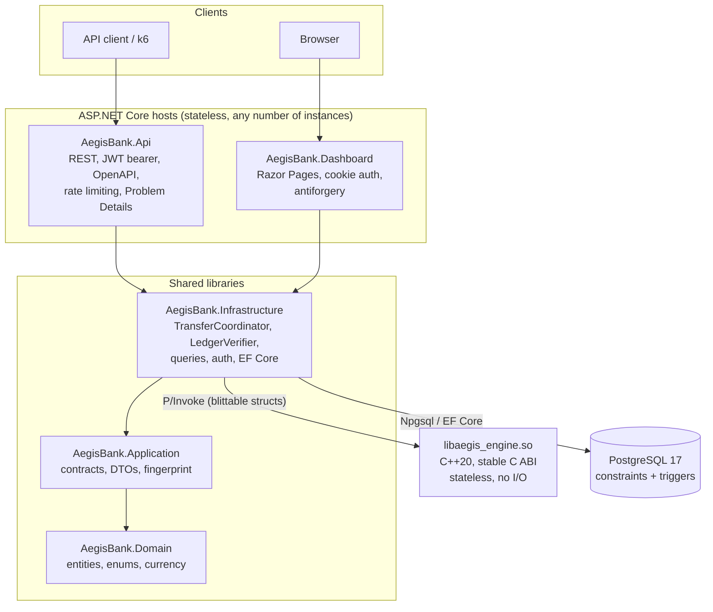

# Architecture

## Components

Dependency direction: `Domain` ← `Application` ← `Infrastructure` ← hosts.
`Domain` references nothing. `Application` defines the interfaces
(`ITransferService`, `ITransferEngine`, query interfaces) that `Infrastructure`
implements. The hosts contain only HTTP concerns.

## Why two hosts

The API and the dashboard have different authentication models (bearer tokens
vs. cookies with CSRF protection) and different audiences. Keeping them in
separate processes means a cookie can never authenticate an API call and the
API never needs antiforgery. Both call the same `ITransferService`; the
dashboard does not go through HTTP.

Running two processes against one database is also a standing multi-instance
test: correctness cannot depend on anything held in one process's memory.

## Division of responsibility

| Concern | Owner |
|---|---|
| Is this transfer allowed? What are the resulting balances and ledger lines? | C++ engine |
| Authentication, ownership, request shape | ASP.NET Core host + coordinator pre-checks |
| Atomicity, isolation, locking, idempotency, retries | `TransferCoordinator` + PostgreSQL |
| Last line of defence (balanced journals, immutability, non-negative balances) | PostgreSQL constraints and triggers |
| After-the-fact proof that everything adds up | `LedgerVerifier` |

The engine never sees a database connection and keeps no state between
calls. The coordinator never decides whether a transfer is allowed; it
supplies committed, row-locked balances and persists what the engine returns,
after cross-checking the decision (`VerifyDecision`).

## Native interoperability

The engine is a C++20 library (`src/AegisBank.Engine`) whose only public
surface is the C header `include/aegis/engine.h`.

**ABI rules**

- Plain C structs with explicit-width integers; every field offset is fixed
  and there is no implicit padding (verified with `static_assert`).
- Top-level structs start with `struct_size` and `abi_version`. A caller built
  against a different header is rejected with `AEGIS_ERR_ABI_MISMATCH` instead
  of being misread. The decision struct is not written at all when its
  declared size is wrong.
- The caller owns all memory. The engine allocates nothing for the caller and
  keeps no pointer after returning. Strings returned by the engine
  (`aegis_engine_version`, `aegis_result_name`) are static and never freed.
- No STL type and no exception crosses the boundary. `extern "C"` functions
  catch everything and return `AEGIS_ERR_INTERNAL`.
- The engine is stateless and re-entrant; any number of threads may call it.

| Struct | Size | Notes |
|---|---:|---|
| `aegis_account_snapshot` | 32 | 16-byte id, balance, ISO 4217 numeric currency, status, normal side |
| `aegis_transfer_request` | 88 | header + debit account + credit account + amount + currency |
| `aegis_ledger_instruction` | 32 | account id, debit, credit |
| `aegis_transfer_decision` | 96 | header + result code + balances after + two instructions |

**Managed side** (`Infrastructure/Native`)

- `NativeMethods` declares the functions with `[LibraryImport]` (source
  generated, no runtime marshalling). The mirror structs are blittable and are
  passed by pointer from the stack.
- `NativeTransferEngine` is the only type that touches pointers. On first use
  it compares the managed struct sizes and two field offsets, and the ABI
  version, with what the loaded library reports
  (`aegis_sizeof_*`, `aegis_offsetof_*`). A mismatch disables the engine and
  the readiness probe fails.
- Results are copied into managed value types (`EngineDecision`) before the
  call returns.
- Library resolution: `AEGIS_ENGINE_PATH` (file or directory) if set, then the
  application directory, then default probing. The build copies
  `artifacts/native/libaegis_engine.so` next to every binary that references
  `AegisBank.Infrastructure`.

**Build integration**

`scripts/build-engine.sh` runs CMake, runs the GoogleTest suite, and copies the
library to `artifacts/native/`. The Dockerfile does the same in its first
stage; the image build fails if a native test fails or the library is missing
from the published output.

## Configuration

Everything environment-specific comes from configuration (environment
variables in containers). The keys are listed in `.env.example` and in
[security.md](security.md). There are no secrets in `appsettings*.json`.

## Health

`/health/live` answers when the process is running. `/health/ready` runs two
checks: PostgreSQL connectivity and a known-answer call into the native engine
(100 from a balance of 150 must leave 50). Compose and the Dockerfile use the
readiness endpoint as the container health check.
