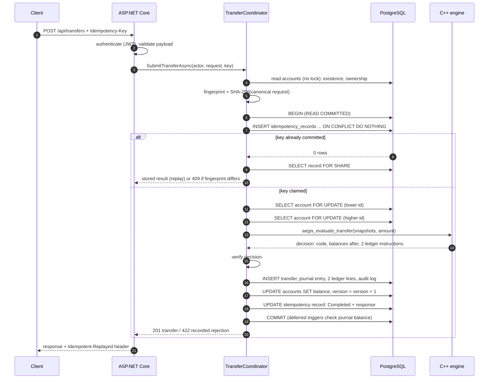

# Transaction flow

Everything below is implemented in
`src/AegisBank.Infrastructure/Transfers/TransferCoordinator.cs`.

## Sequence

## Steps and what each one protects

1. **Authenticate and validate.** JWT bearer. The body must have two distinct
   account ids, a positive integer amount in minor units and a supported
   currency. The `Idempotency-Key` header (8–128 printable ASCII characters)
   is mandatory. Failures here return 400 and record nothing, so the key
   stays usable.
2. **Ownership pre-check** (outside the transaction). A customer may debit
   only their own accounts. An account the caller may not see is reported as
   404. System accounts cannot be a source or destination of a customer
   transfer.
3. **Fingerprint.** `SHA-256("v1|kind|actor|source|destination|amount|currency|reversalOf")`
   with GUIDs in fixed-width form. It does not depend on JSON formatting.
4. **Claim the key.** One `INSERT … ON CONFLICT (actor_id, idempotency_key) DO NOTHING`
   inside the transaction. The unique index makes the claim atomic:
   - nobody holds the key → the row is inserted, we proceed;
   - a *committed* row exists → 0 rows affected, we read it and replay or
     return 409;
   - an *uncommitted* row exists (a concurrent request with the same key) →
     PostgreSQL blocks the insert until that transaction ends, then one of the
     two cases above applies.

   Because the claim and the outcome are written in the same transaction, a
   committed record is always complete. There is no "in progress" state that
   another request could observe, and nothing to clean up after a crash.
5. **Lock both accounts** with `SELECT … FOR UPDATE`, always the lower id
   first. See *Deadlocks* below.
6. **Read balances** from the locked rows. They are committed values and
   cannot change until we commit or roll back.
7. **Ask the engine.** The engine validates amount, distinct accounts,
   currency, status, sufficient funds and overflow, and returns either a
   rejection code or the two balances and two ledger instructions.
8. **Verify the decision.** The coordinator checks that the instructions name
   the right accounts, that debit equals credit equals the amount, and that
   the balances match an independent checked computation. A mismatch aborts
   the transaction (it would indicate a defect, not a user error).
9. **Persist.** Approved: transfer (`Completed`), journal entry, two ledger
   lines, both balance projections, audit log. Rejected by the engine:
   transfer (`Rejected`, with the engine's code), audit log, **no** journal
   and no balance change.
10. **Store the response** in the idempotency record.
11. **Commit.** Deferred constraint triggers verify that the journal is
    balanced and that a completed transfer has exactly one journal for its
    amount. If anything fails, everything is rolled back.

## Idempotency semantics

| Situation | Result |
|---|---|
| New key | Request is processed; 201 or 422 |
| Same key, same request, after commit | Stored status and body, header `Idempotent-Replayed: true` |
| Same key, same request, concurrently | One executes; the others wait on the unique index and then replay |
| Same key, different request | 409 `idempotency_key_conflict`; nothing is posted |
| Same key after a failed attempt (crash, 5xx, validation error) | Processed as new: the failed attempt left no record |

Keys are scoped per user: two users can use the same key independently.
A second, permanent barrier is the unique index on
`transfers (initiated_by_user_id, idempotency_key)`.

Rejections are stored too, so repeating a rejected request returns the same
422 rather than re-evaluating against a balance that may have changed.

## Concurrency

Isolation level is READ COMMITTED with explicit row locks. This is sufficient
here because every value the decision depends on (the two balances and
statuses) is read from rows locked `FOR UPDATE` in the same transaction.
There is no predicate read whose result could be invalidated, so SERIALIZABLE
would add retries without adding safety.

Two transfers from the same account: the second blocks at step 5 until the
first commits, then reads the reduced balance. Overdraft through a race is
impossible.

Nothing relies on an in-process lock. Two application instances behave
exactly like two threads in one instance, because the only coordination point
is the database.

Account status changes (`freeze`, `close`) take the same row lock, so a status
change never interleaves with a posting.

`accounts.version` is an EF Core concurrency token and is incremented on
every balance change. With the row locks in place it should never fire; it is
defence in depth against a future code path that forgets to lock.

## Deadlocks

Locks are always requested in ascending account-id order. Two transfers
between the same pair of accounts, in opposite directions, therefore ask for
the same lock first and queue instead of deadlocking. The idempotency row is
claimed before any account lock, in every code path, so it cannot be part of
a cycle either.

If PostgreSQL still reports `40P01` (deadlock) or `40001` (serialization
failure), or EF reports a stale `version`, the **whole unit of work** is
retried on a fresh connection: up to `Transfers:MaxAttempts` (default 4)
attempts with exponential backoff and jitter, honouring cancellation. This is
safe because the failed attempt was rolled back completely. Other errors are
never retried. When attempts are exhausted the caller gets 503
`transfer_contention` and can retry with the same key.

## Failure handling

| Failure | Effect |
|---|---|
| Exception anywhere before commit | Transaction rolled back by disposal; no transfer, journal, balance change, audit row or idempotency record |
| Process killed before commit | Same: PostgreSQL aborts the open transaction |
| Process killed after commit, before the response is sent | Transfer is committed; the client's retry with the same key gets the stored result |
| Client cancels | `CancellationToken` flows to every database call; rollback |
| Engine library missing | Readiness probe fails; a transfer attempt fails with 500 and rolls back |

These cases are exercised by `tests/AegisBank.ConcurrencyTests/FailureAndRecoveryTests.cs`
through a fault-injection hook (`ITransferFaultInjector`) that fires at four
points inside the transaction.

## Other postings

Opening deposits and reversals use the same unit of work with different
accounts:

| Kind | Debit | Credit |
|---|---|---|
| Internal transfer | source customer account | destination customer account |
| Opening deposit | Vault cash (system asset) | customer account |
| Reversal | account credited by the original | account debited by the original |

A reversal is a new transfer with its own journal entry. A partial unique
index allows at most one completed reversal per original transfer.
